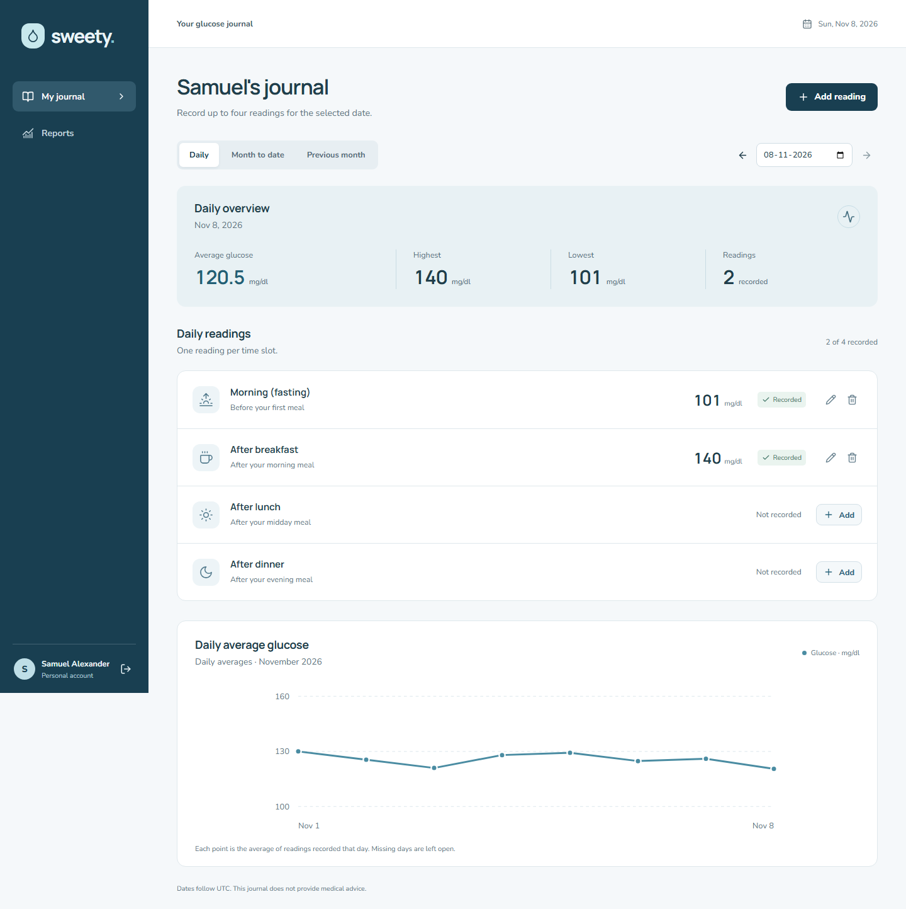

# Sweety

A personal blood glucose journal built with React, Express, and PostgreSQL. Record up to four readings a day, edit your journal, and view daily, month-to-date, and previous-month reports.



## Run locally

Requires Node.js 22.12 or later, npm, and PostgreSQL 17 (or Docker Desktop for the database).

```sh
git clone https://github.com/SamuelAlex013/sweety-glucose-tracker.git
cd sweety-glucose-tracker
npm ci
cp .env.example .env
docker compose up -d --wait
npm run db:migrate
npm run db:seed
npm run dev
```

On PowerShell, use `Copy-Item .env.example .env` instead of `cp` if needed. Start Docker Desktop before the Compose command. Compose creates the `sweety` database and stores it in a named volume. The example database password is for local development only. If port 5432 is occupied, change the host port in Compose and the port in both database URLs in `.env`.

Open **[http://localhost:5173](http://localhost:5173)**. Use this exact origin, matching `APP_ORIGIN` in `.env`. The API runs on port 3001; Vite proxies `/api` requests to it.

Demo account: **Samuel Alexander**. Login: **demo@sweety.local** / **SweetyDemo2026!**. All seeded data is synthetic. The seed fills the previous month and current month through today, leaving two slots open today. Running it again updates the demo name and preserves existing readings and passwords. It is intended for a fresh demo account, not for adding data to a real patient's journal.

### Existing PostgreSQL instead of Docker

Create a database with `createdb -U postgres sweety`, then set `DATABASE_URL` in `.env` to your own PostgreSQL connection string. The migration role needs permission to create tables and indexes. Run `npm run db:migrate` and the remaining commands above. The SQL migration is checked in so constraints are reviewable; the npm command applies it transactionally and records its version. Re-running it is safe.

### Run each part separately

```sh
npm run dev -w server
npm run dev -w client
```

These are separate terminal commands. Or use `npm run dev` to run both together.

### Production build

```sh
npm run build
npm run db:migrate
```

Set `NODE_ENV=production`, `APP_ORIGIN=https://your-domain.example`, and your production `DATABASE_URL`, then run `npm start`. Express serves the built client and API together. Terminate HTTPS at a reverse proxy; set `TRUST_PROXY=1` only when behind a trusted single proxy. Production session cookies require HTTPS. Keep `.env` and database credentials outside Git.

## Tests

```sh
npm test
```

Runs domain tests and React Testing Library form tests. They cover value/date validation, leap-year and January report boundaries, form submissions, and server conflict feedback.

For PostgreSQL integration tests, create a test database once:

```sh
docker compose exec db createdb -U sweety sweety_test
```

With a native install, use `createdb -U postgres sweety_test`. Set `TEST_DATABASE_URL` to that database in `.env`, then run:

```sh
npm run test:integration
```

The suite creates a uniquely named schema, migrates it, tests the real API and PostgreSQL constraints, then drops only that schema. It checks bcrypt storage, session expiry/logout, account isolation, CRUD, all required validations, concurrent duplicate submissions, report aggregates, moving readings into occupied slots, and recovery after an idle database connection is terminated. The test database role needs permission to create schemas.

For end-to-end browser tests:

```sh
npx playwright install chromium
npm run db:migrate
npm run test:e2e
```

Playwright starts the dev server if it is not already running. It uses the configured `DATABASE_URL`, registers unique test accounts, and exercises the complete journal flow and mobile layout. Use a development/test database: these browser tests leave their test accounts in that database. GitHub Actions runs unit, form, integration, build, and browser checks against its own PostgreSQL service.

Other checks: `npm run format:check`, `npm run build`, and `npm audit`.

## Behavior and API

Every reading has a date, slot, and integer value from **40–600 mg/dl**. The four slots are Morning (fasting), After breakfast, After lunch, and After dinner. The form and API share validation; PostgreSQL also enforces valid slots, value bounds, and uniqueness. Four permitted slots plus one reading per slot enforce the daily maximum, even with concurrent submissions. User writes are serialized in a transaction so duplicate and full-day errors remain clear.

All reading and report endpoints require an HTTP-only session cookie and scope their queries to the authenticated user. Passwords use bcrypt with cost 12. Random session tokens are stored as SHA-256 hashes, expire after seven days, and are revoked on logout. Authentication endpoints are rate limited. Writes require JSON where applicable and reject other browser origins. No authentication tokens are stored in browser storage.

| Method | Endpoint                        | Purpose                                                   |
| ------ | ------------------------------- | --------------------------------------------------------- |
| POST   | `/api/auth/register`            | `{name, email, password}`; creates an account and session |
| POST   | `/api/auth/login`               | `{email, password}`; starts a session                     |
| GET    | `/api/auth/me`                  | Current account                                           |
| POST   | `/api/auth/logout`              | Revokes the session; send `{}`                            |
| GET    | `/api/readings?date=YYYY-MM-DD` | Own readings; date filter is optional                     |
| POST   | `/api/readings`                 | `{date, slot, value}`                                     |
| PUT    | `/api/readings/:id`             | Replaces the reading's date, slot, and value              |
| DELETE | `/api/readings/:id`             | Deletes an owned reading                                  |
| GET    | `/api/reports?date=YYYY-MM-DD`  | All three reports for a selected date                     |
| GET    | `/api/config`                   | Server calendar date and configured timezone              |
| GET    | `/api/health`                   | Database connectivity check                               |

Slot IDs are `morning`, `breakfast`, `lunch`, and `dinner`. Validation responses contain a `message` and optional `fields`. Missing/invalid data returns 400, a duplicate or full day returns 409, and an unowned/missing reading returns 404.

Daily reports cover the selected date; month-to-date covers the first day of that month through the selected date, inclusive; monthly reports cover the **entire previous calendar month**. For 15 October 2026, those are 15 October, 1–15 October, and 1–30 September. Each report includes count, highest, lowest, and average; the UI displays the average to one decimal. Empty reports have count zero and null statistics. The daily report lists all four slots and their recorded values.

The chart shows daily averages from actual stored readings. It leaves gaps for missing days and does not infer values or clinical target ranges.

## Structure

```text
client/src/components/   Journal, form, reports, chart, and authentication UI
client/src/api.js        Shared HTTP client and API error handling
server/src/             Express routes, sessions, database pool, configuration
server/db/              Versioned PostgreSQL schema
server/scripts/         Migration runner and synthetic demo seed
shared/domain.js        Slot definitions, validation, and calendar boundaries
server/test/            Domain and real-PostgreSQL API tests
client/src/test/        Reading form interaction tests
e2e/                    Playwright desktop/mobile workflow tests
docs/screenshots/       Screenshots of the working app with synthetic data
```

## Screenshots and design

The interface draws on the clear dashboard hierarchy and period controls in [Lovable's Customer Health Dashboard](https://lovable.dev/templates/apps/internal-tools/customer-health-dashboard-template), adapted into a four-slot personal journal. The implementation, branding, and assets are original. Manrope and Nunito Sans are self-hosted through Fontsource; icons use Lucide.

- [Login](docs/screenshots/login.png)
- [Daily journal — desktop](docs/screenshots/daily-desktop.png)
- [Daily journal — mobile](docs/screenshots/daily-mobile.png)
- [Month-to-date report](docs/screenshots/monthly-desktop.png)
- [Form validation](docs/screenshots/validation-desktop.png)

All screenshots show synthetic demo data. To reproduce them, seed the demo account, run the dev server, install Playwright's Chromium, then run `npm run screenshots`. It uses `APP_ORIGIN`, `DEMO_EMAIL`, and `DEMO_PASSWORD` from `.env` and does not save or change readings.

## Notes

- PostgreSQL is used as explicitly required; MongoDB is not included despite the MERN shorthand in the assignment.
- Dates follow `APP_TIMEZONE` (UTC by default), shared by validation, reports, and seed data. The footer displays the timezone. Refresh the page when the calendar day changes. The earliest supported date is 1 January 1900.
- Registration signs the patient in immediately. Email addresses are trimmed and lowercased. Passwords require at least eight characters and no more than 72 UTF-8 bytes, avoiding bcrypt truncation.
- This is a single-patient-account journal. It calculates descriptive statistics without diagnosis or treatment recommendations.
- Optional work included: a responsive daily-average chart, PostgreSQL Compose setup, frontend form tests, and browser tests. Pagination, Redis, reminder jobs, and doctor roles are left out to keep the required app focused.
- With more time: password recovery/email verification, per-user timezone preferences, paginated historical records, accessibility testing with assistive technology, backup/restore procedures, and a shared rate-limit store for multiple API instances.

The Compose definition starts PostgreSQL; the Express API and React development server run on the host. It was verified on Windows with Docker Engine 28.3.2, Compose 2.38.2, and containerized PostgreSQL 17.11. An isolated project used host port 55433 because the native PostgreSQL installation already occupied 5432. Migrations, the Samuel Alexander seed, all 9 API/database tests, and both browser tests passed against that container.

Restart checks verified that the API reconnects after PostgreSQL closes an idle connection. Removing and recreating the container without deleting its named volume preserved the 154 demo readings and browser-created accounts. The temporary test containers and servers were stopped afterward; the test volume was retained. Native PostgreSQL 17 was also verified separately.

## Requirement verification

Reviewed against the assignment on 8 November 2026. The automated suites contain 18 tests; their assertions cover multiple cases per test.

| Required area                                 | Verification                                                                                                                                                                              |
| --------------------------------------------- | ----------------------------------------------------------------------------------------------------------------------------------------------------------------------------------------- |
| Registration, login, bcrypt, private readings | PostgreSQL API tests check password hashing, authentication, session expiry, and isolation between accounts.                                                                              |
| Add, view, edit, delete                       | Browser workflow covers the full lifecycle; API tests verify persisted changes and ownership restrictions.                                                                                |
| All five reading validation rules             | Browser assertions check required values, range/whole numbers, duplicate slots, the four-reading limit, and future dates. API and database checks also cover concurrency and constraints. |
| Daily, month-to-date, previous-month reports  | API assertions check counts, min/max, rounded averages, inclusive boundaries, selected-date cutoffs, and empty results. Calendar tests cover January and leap years.                      |
| Daily slots and empty-state UI                | Browser tests verify recorded slots and friendly empty reports.                                                                                                                           |
| Submission materials                          | Public repository with incremental commits, setup/test instructions, `.env.example`, demo seed, screenshots, and Notes are present.                                                       |

The demo account and screenshots use **Samuel Alexander**, with synthetic readings. The quality review removed generic promotional copy, unused slot metadata and CSS, and duplicated frontend slot definitions. Validation and calendar rules are shared by the API and form. The deterministic design scan reported no findings; that is a limited pattern check, not proof of design quality or full accessibility compliance.

Optional chart and frontend tests are implemented. Compose startup, health checks, database initialization, application behavior against the container, restart recovery, and volume persistence have been tested locally. The app has not been deployed to a public web host.
